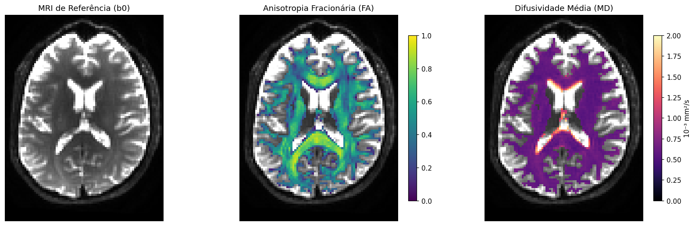
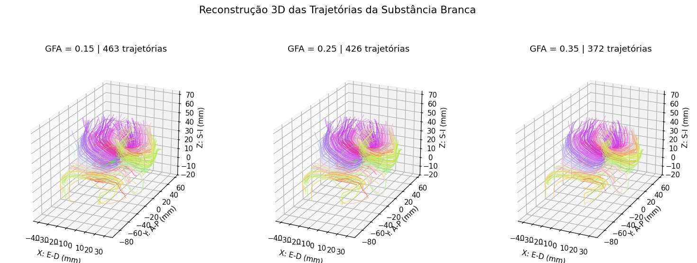
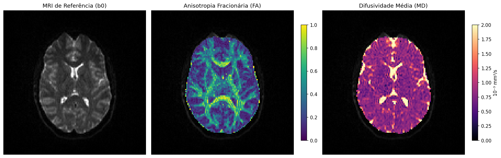
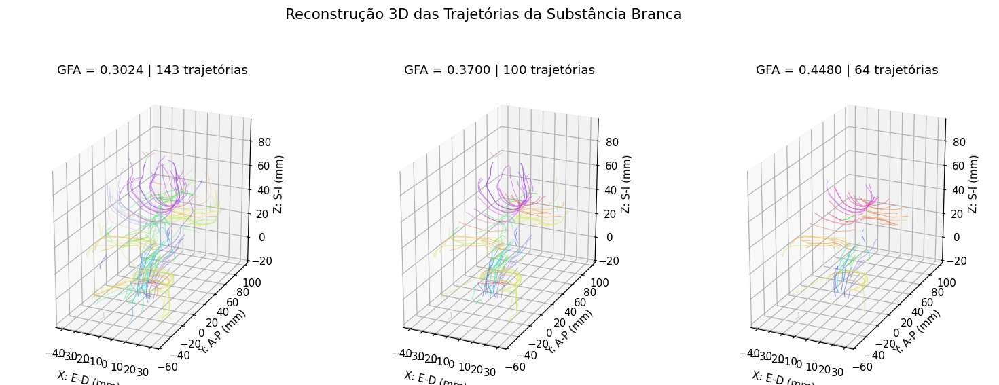

# 🧠 DIPY | Análise de MRI de Difusão e Tractografia Cerebral

**Métodos de Imagem Médica · Engenharia Biomédica · NOVA FCT · 2026/2027**

Este repositório reúne dois *Jupyter Notebooks* que exploram a biblioteca [DIPY — Diffusion Imaging in Python](https://dipy.org/) para analisar imagens de ressonância magnética de difusão (*dMRI*) e reconstruir trajetórias estimadas na substância branca cerebral.

O projeto foi desenvolvido como **demonstrador académico**: inclui o processamento dos dados, a estimativa de medidas de difusão, a tractografia, a comparação de parâmetros e a visualização dos resultados.

## Notebooks

| Ficheiro | Objetivo | Dados |
|---|---|---|
| [`DIPY_Demonstrador.ipynb`](DIPY_Demonstrador.ipynb) | Demonstrador principal: DTI, CSA, GFA e tractografia EuDX; comparação de três limiares de paragem. | **Stanford HARDI**, obtido através do DIPY. |
| [`DIPY_Estudo.ipynb`](DIPY_Estudo.ipynb) | Aplicação adicional da mesma abordagem a uma aquisição real de dMRI, com parâmetros e máscaras adaptados ao participante. | **OpenNeuro ds004513**, participante anonimizado `sub-s028`, sessão `ses-open`. |

**Fluxo de análise:** carregar DWI e gradientes → visualizar MRI → calcular mapas FA/MD (DTI) → estimar orientações e GFA (CSA) → selecionar sementes → reconstruir trajetórias com EuDX → comparar limiares → visualizar em 2D/3D.

## Exemplos de resultados

As imagens seguintes foram extraídas das **saídas já guardadas nos notebooks** (não correspondem a uma nova execução deste repositório).

### 1. Dataset Stanford HARDI

**Mapas DTI — MRI de referência, FA e MD**



**Tractografia tridimensional para diferentes limiares GFA**



### 2. Dados do estudo de Castrillon et al. (2023)

**Mapas DTI para o participante `sub-s028`**



**Reconstrução exploratória de trajetórias**



## Requisitos e instalação

Ambos os notebooks foram preparados num ambiente **Python 3.13.2**. As versões das principais bibliotecas usadas nessa execução estão registadas no ficheiro [`requirements.txt`](requirements.txt) e são mostradas pela primeira célula de cada notebook.

No terminal, na pasta deste repositório, executar:

```bash
python -m pip install -r requirements.txt
jupyter lab
```

> **Nota:** É recomendável criar um ambiente virtual Python antes da instalação, para evitar conflitos com outros projetos. O DIPY pode necessitar de alguns minutos para concluir modelos de reconstrução mais exigentes.

## Obtenção dos dados

### A. Demonstrador (Stanford HARDI)

O notebook principal usa `get_fnames(name="stanford_hardi")` e `get_fnames(name="stanford_labels")`. O **DIPY gere a obtenção/cache destes ficheiros** na primeira utilização; não é necessário incluí-los no GitHub.

### B. Aplicação ao estudo (OpenNeuro)

O segundo notebook **não descarrega automaticamente ficheiros**. Obter os ficheiros de difusão, `.bval` e `.bvec`, correspondentes à mesma aquisição, no [dataset público OpenNeuro ds004513](https://openneuro.org/datasets/ds004513).

Organizar a estrutura de diretórios assim, **a partir da pasta do repositório**:

```text
dipy-mri-tractography/
├── DIPY_Demonstrador.ipynb
├── DIPY_Estudo.ipynb
├── ds004513/                  ← pasta local, não incluída no GitHub
│   └── sub-s028/
│       └── ses-open/
│           └── dwi/
│               ├── <prefixo>_dwi.nii.gz
│               ├── <prefixo>_dwi.bval
│               └── <prefixo>_dwi.bvec
├── figuras_exemplo/
├── requirements.txt
└── README.md
```

O notebook procura um ficheiro terminado em `_dwi.nii.gz` dentro de `ds004513/sub-s028/ses-open/dwi/` e determina os nomes de `.bval`/`.bvec` a partir do mesmo prefixo. **Não misturar ficheiros de aquisições diferentes.** Se houver vários conjuntos DWI, deixar apenas a aquisição pretendida nessa pasta para evitar seleção acidental.

A pasta de dados e os ficheiros NIfTI estão excluídos pelo `.gitignore`: **não redistribuir os dados originais neste repositório**.

## Como reproduzir

1. Instalar as dependências e obter os dados necessários.
2. Abrir o notebook pretendido a partir da pasta do repositório.
3. Executar **Kernel → Restart & Run All**.
4. Consultar mapas quantitativos, tabela comparativa, gráficos e visualização 3D.
5. Se ativadas, as exportações individuais das figuras serão guardadas em `figuras(DIPY_Demonstrador)/` ou `figuras(DIPY_Estudo)/` (pastas locais excluídas do controlo de versões).

## Enquadramento e limitações

- **DTI** produz mapas de anisotropia fracionária (**FA**) e difusividade média (**MD**).
- **CSA** estima orientações preferenciais de difusão e a anisotropia fracionária generalizada (**GFA**).
- **EuDX** constrói trajetórias computacionais a partir de sementes e critérios de paragem; o número de trajetórias depende dos parâmetros escolhidos.
- A aplicação ao OpenNeuro utiliza **máscaras aproximadas** e um fluxo didático: **não reproduz** as correções, a tractografia anatomicamente condicionada e as análises multimodais PET/fMRI dos autores.
- **Trajetórias não representam diretamente axónios**, e diferenças nas contagens não provam diferenças de conectividade biológica.

## Fontes e referências

- [DIPY — página oficial e documentação](https://dipy.org/)
- Castrillon *et al.* (2023). *An energy costly architecture of neuromodulators for human brain evolution and cognition*. *Science Advances*. [Artigo científico (DOI)](https://doi.org/10.1126/sciadv.adi7632)
- [OpenNeuro — Dataset ds004513](https://openneuro.org/datasets/ds004513)
- [Repositório dos autores do artigo — NeuroenergeticsLab](https://github.com/NeuroenergeticsLab/energetic_costs)
